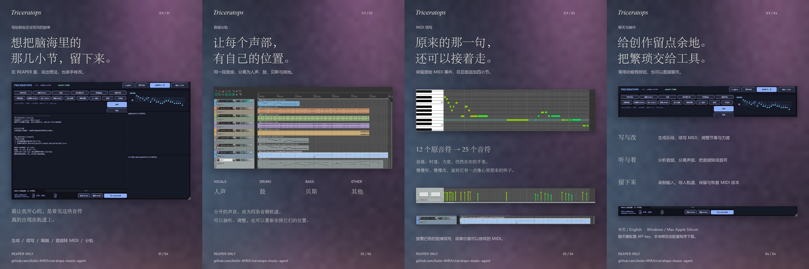

# Triceratops Music Agent · 0.9

[中文](readme.md) | [English](README.en.md)

**Keep the next few bars inside your REAPER project.**

Triceratops is a music Agent VST3 for REAPER. Describe an idea naturally or use the action buttons to generate, continue, edit and analyze MIDI, then import editable results into real REAPER tracks.

**v0.9 supports REAPER only. Windows uses a native Python backend; WSL is not required.** Chat and intent rewriting use your configured Qwen / OpenAI-compatible API. Music generation, continuation, stem separation and transcription run locally.

## Local fixes and validation for v1.0.1

This work starts from `main`. The Windows 1.0 update will be merged and retested before a combined v1.0.1 release. Published attachments remain v0.9.0; the local results below are a partial validation record.

- **Shared runtime fixes:** report failed mutations accurately, stop their tool loop, terminate owned model processes on cancellation or backend exit, preserve events and expression outside MIDI-GPT infill selections, retain short notes during quantization, edit drum timing/velocity correctly, redact errors, verify pinned model/decoder assets and explicitly retry the same official revision after mirror failures, and restore Basic Pitch's `pkg_resources` dependency. MIDI-LLM precision is explicitly configurable; existing default precision and device selection are retained. Explicit drum/instrument constraints retain raw MIDI and an audit of postprocessing. Required native dispatch prevents unexecuted promises; completed music operations receive factual reports. Generated continuation tails are bounded to requested bars with raw tails retained. Fractional-PPQ quantization, final short-note bounds and trailing rests are preserved, and the plug-in reconnects an exited backend asynchronously. Recording state and auto-import preferences survive editor reopen; full two-minute audio buffers remain saveable and same-second captures do not overwrite. Memory corrections are atomic, saved facts are read from disk, empty deletion is rejected and saving cannot trigger an unrequested deletion. Knowledge questions progress from lookup to an answer, with execution evidence retained on failure.
- **macOS fixes:** require native ARM64 Python, preserve existing paths/device/API settings, restrict configuration and backups to `0600`, validate installation before replacing and backing up the VST3, and exclude native Mac processes from legacy Linux worker cleanup, and save recordings under `~/Library/Application Support/Triceratops/Captures`.
- **Actual REAPER checks:** an 8 GB A18 Pro Mac running macOS 27.0.1, ARM64 Python 3.11.17 and REAPER 7.82 scanned and loaded the rebuilt VST3, started its backend, switched interface languages, invoked Basic Pitch through Qwen native tool calls, imported real MIDI automatically and manually, opened its piano roll, and rendered an eight-second Apple DLSMusicDevice piano audition. Natural-language MIDI-LLM generation also ran in the host (CPU/float16, 512-token cap, about 124 seconds): raw output had 170 notes including 45 drum notes; explicit postprocessing retained all tonal events and delivered 125 piano notes with no drums. Host MIDI-GPT continuation retained the original 125-note stream, added 97 notes and clipped three releases to eight bars / 16 seconds, then actually auto-imported. Host quantization, velocity, transposition, Undo and targeted infill were checked against real events. All four HTDemucs stems were actually imported, played and rendered; internal host routing captured 16 MIDI notes and about eight seconds of non-silent audio. Audio device selection belongs to REAPER's user settings; the plug-in does not fix a sound card.
- **Model/backend checks:** real CPU MIDI-GPT continuation and infill with event comparisons; two HTDemucs four-stem runs on eight seconds of original audio (about 8.02 / 6.60 seconds); Basic Pitch on `CPUExecutionProvider`; file/event checks for editing, Undo, feedback, memory and retrieval. Host checks also covered model-child termination after cancellation, invalid API 401, network failure, missing-model/MIDI errors and recovery; original configuration fields and `0600` permissions were restored. Generated piano was actually played through Apple DLSMusicDevice, opened in the piano roll and rendered to an eight-second audition. The local regression suite passes 83 tests. These do not certify every GUI flow or a Windows retest.
- **Pending:** interface/default-input paths, arbitrary selected-item context and remaining failure scenarios; recording-state, preference persistence and two-minute capacity fixes have passed host retests. System-default output playback works; Studio 26c output-only initialization still blocks in CoreAudio I/O callback registration and is not a sound-card pass. Authentic window-sampled videos (about 0.7–1.5 fps, not full-frame continuous recording), host reopen and automatic backend-exit recovery have been verified. Arbitrary selected-item capture is still pending; host continuation/edit checks currently use MIDI loaded in the plug-in. VST3 chat context does not yet supply the real project path: verified memory CRUD uses its local VST3 memory file, not certified isolation between projects. This context integration must be reconciled with the Windows 1.0 feature update. Default CPU/float32 MIDI-LLM timed out at 300 seconds with a 96-token cap on this Mac. Explicit CPU/float16 produced valid MIDI twice in about 30 seconds, but wrong instruments or drums in raw output failed the requested musical constraints. Explicit postprocessing can enforce instrument/drum constraints; it does not establish mood, sparse phrasing or musical quality. Only MIDI-GPT has been tested on MPS; this is not evidence of GPU support for every model.

Measurements apply to this Mac, not a certified minimum or speed guarantee for all Macs.

### Logic AU and REAPER import regression (local, pending v1.0.1)

macOS now builds `Triceratops MIDI` for Logic MIDI FX before the instrument and `Triceratops Audio` for Audio FX. Both use the same backend and pinned models. Logic 12.4 actually loaded both AUs: native API chat, MIDI-LLM generation, 24-note MIDI output and input capture, internal electric-piano audio recording, and Basic Pitch transcription followed by real piano-roll import passed. Original generated MIDI, hashes and postprocessing counts are retained when drum constraints or duplicate/retrigger cleanup are applied. Empty MIDI capture reports an error. POSIX backend startup restores SIGTERM; whole AU bundles are re-signed and strictly verified after incremental linking. Native drag-to-track completion remains unverified; use Logic's tested MIDI file import. Audio devices remain the host user's choice.

**Shared fix:** unique import request IDs require matching host receipts with the actual project and imported count. Atomic receipt publication rejects stale success, errors are displayed, and the import button prevents repeated requests. Windows keeps its existing `-nonewinst` launch path and awaits a physical Windows retest. **Mac fix:** command-line imports could open a second REAPER instance. Import now runs through the owning VST3 host's API on its UI thread, retaining the host interface and resolving its project parent after initialization. An inactive owning project produces an explicit error without launching another host.

REAPER 7.82 regression reused an earlier genuine 24-note MIDI-LLM result, then actually invoked Qwen's quantization tool through the plug-in. All 24 pitches, velocities and channels survived; 17 onsets changed, with at most 0.01 beat rounding at 50 PPQ. Manual and automatic imports, rapid repeat-click protection, exact host import Undo, normal quit/reopen and project persistence passed in a separate test copy. Actual DLSMusicDevice piano playback was captured into a 6.82-second audition and an authentic 53-frame / 6.13-second sampled window video. Both rebuilt AUs again passed strict signatures, Apple auval and actual Logic MIDI/audio capture. There are 83 passing regression tests. Import project checks do not certify chat context, memory or history isolation across projects; these and the final Windows merge still require validation.

## Download and install

- [Windows x64 EXE installer](https://github.com/Aolin-MIR/triceratops-music-agent/releases/download/v0.9.0/Triceratops-0.9.0-Windows-x64-Setup.exe)
- [Release notes, checksums and available assets](https://github.com/Aolin-MIR/triceratops-music-agent/releases/tag/v0.9.0)
- [macOS Apple Silicon ZIP](https://github.com/Aolin-MIR/triceratops-music-agent/releases/download/v0.9.0/Triceratops-0.9.0-macOS-AppleSilicon.zip): requires **Apple Silicon, macOS 14+, and native ARM64 Python 3.10 / 3.11**. Extract and keep the directory, then run `bash setup-macos.sh`. The universal VST3 build passed; partial REAPER checks on a physical Mac are recorded above. Intel Mac model execution is not supported.

1. Save your project and close REAPER. Run the EXE. The single VST3 installation is `C:\Program Files\Common Files\VST3\Triceratops.vst3`.
2. Open **Configure runtime and download models** at the end of installation or from the Start menu. Select REAPER, a model directory and compute device; enter your own API key. A dedicated native Python seed is included, without modifying system Python.
3. First setup downloads runtime packages and models. It defaults to the Tsinghua PyPI mirror and `hf-mirror.com`. Failed downloads report an error; rerun setup to resume. Missing models never silently select a different generator.
4. In REAPER, open **Preferences → Plug-ins → VST → Re-scan**, then insert **Triceratops**.
5. Rerun configuration to change settings or download missing files. Uninstalling the application retains user models, credentials and generated work for backup or manual removal.

The EXE includes the plug-in, configuration utility and Python seed. **Large weights are downloaded by setup, not embedded in the EXE.** CPU is the default. An unavailable selected device produces an error rather than a silent device switch.

Use **中文 / English** in the plug-in header to switch buttons, status text, hints and operation reports. The language preference is remembered; chat defaults to the selected interface language.

## System requirements

**Software constraints, suggested resource budgets and tested configurations are different.** A full-feature minimum has not been established by testing machines with different memory capacities; these recommendations are not certified minimums.

| Item | Windows | macOS |
| --- | --- | --- |
| OS / architecture | Windows 10 / 11 x64; Windows 11 tested, Windows 10 not separately verified | Apple Silicon (M1 or newer), macOS 14+; Intel Mac model execution is unsupported |
| Host | REAPER x64; 7.80 tested, 7.80 or newer recommended | Native Apple Silicon REAPER, 7.80 or newer recommended; full physical-machine testing pending |
| Python | Dedicated Python 3.11.9 included; no WSL required | User-installed native ARM64 Python 3.10 / 3.11; setup looks for `python3.11` by default |
| Memory budget | Start with 16 GB for CPU use; 32 GB gives more room for instruments / longer audio; not a measured minimum | Start with 16 GB unified memory, preferably 32 GB; 8 GB A18 Pro measurements have started; default CPU/float32 MIDI-LLM showed severe resource pressure and timed out, so full-feature validation has not passed |
| Graphics | No discrete GPU needed for CPU mode; the current CUDA path uses BF16, so a BF16-capable Ampere or newer NVIDIA GPU and a conservative 16 GB VRAM budget are recommended | Setup selects CPU; MIDI-GPT has separately run on MPS, while other model acceleration and MLX remain unvalidated |
| Free storage budget | Reserve 20 GB for CPU or 30 GB for CUDA installation, plus download caches, audio and projects | Reserve 20 GB, plus download caches, audio and projects |
| Network / API | Internet for initial dependencies / weights; current chat and button tool dispatch need a user-configured API with native tool calling | Same; the Mac ZIP includes neither Python nor model weights |

Storage and memory figures are conservative planning recommendations, not measured peaks for every feature. Approximately 4 GB of weights does not mean a 4 GB installation or runtime footprint. CPU generation is an offline task with no real-time guarantee. CUDA also requires an NVIDIA driver that can run the installer's `cu130` PyTorch build; the CUDA version shown by `nvidia-smi` alone does not prove compatibility. AMD / Intel GPU acceleration, Windows ARM64 and Intel Mac are outside current support.

See **[System requirements and support scope (中文 / English)](docs/SYSTEM_REQUIREMENTS.md)** for evidence, tested configurations and differences between features.

## Features

| Action | Implementation |
| --- | --- |
| Chat / New score | Native LLM tool-calling loop, intent rewriting and local MIDI-LLM generation |
| Edit MIDI / More energy / Tighten timing | Explicit transposition, velocity and timing edits |
| Continue 4 bars / bar infill | MIDI-GPT generates new content; continuation appends bars while retaining original MIDI events |
| Analyze | MIDI note and rhythm statistics; estimated audio tempo/key, onsets and sections |
| Stem split | Demucs HTDemucs: vocals, drums, bass and other |
| Audio → MIDI | Basic Pitch ONNX transcription |
| Rec MIDI / Rec audio | Capture signals routed into the plug-in |
| Auto-Import / Import to REAPER | Add generated MIDI or separated audio to new REAPER tracks; automatic import can be disabled |
| Keep / Reject / Undo | Store preference feedback and restore the previous MIDI version; this does not delete previously imported host tracks |
| Memory / RAG | Persist project constraints, preferences and conversation summaries; retrieve local knowledge and project notes |

Examples: “Sparse piano and cello for an overcast evening”, “Continue this clip for four bars”, or “Tighten the rhythm while keeping the melody.” No JSON or rigid prompt template is required. Editing operations are limited to the transformations exposed by the tools.

MIDI needs an instrument in REAPER to produce sound. Transcription and separation can contain model errors; reported audio key is an estimate.

## Models and licenses

| Model | Purpose / download | License |
| --- | --- | --- |
| [MIDI-LLM](https://huggingface.co/slseanwu/MIDI-LLM_Llama-3.2-1B) | Text-to-MIDI, approximately 3.45 GB, pinned revision | Llama 3.2 Community License; Built with Llama |
| [MIDI-GPT Yellow Medium](https://huggingface.co/Metacreation/MIDI-GPT) | Continuation / infill, approximately 351 MB, pinned revision | Weights: CC BY-NC 4.0, noncommercial use |
| [HTDemucs](https://huggingface.co/adefossez/HTDemucs) | Four-stem separation | See model card and Demucs upstream license |
| [Basic Pitch](https://github.com/spotify/basic-pitch) | ONNX weights installed with the package | Apache 2.0 |

The downloader checks SHA-256 for MIDI-LLM, MIDI-GPT, HTDemucs and decoder assets; Basic Pitch ONNX weights are also verified. Exact repositories, revisions and hashes are in [`download_models.py`](text2music/agent/download_models.py). Source availability does not give every model the same license. In particular, MIDI-GPT weights have a noncommercial restriction. See [THIRD_PARTY_NOTICES.md](THIRD_PARTY_NOTICES.md).

## Configuration and privacy

Windows settings: `%APPDATA%\Triceratops\runtime.json`; dedicated Python and weights: `%LOCALAPPDATA%\Triceratops\`; generated work and memory: `%APPDATA%\Triceratops\runs\`. Keys stay in the user-owned configuration and are excluded from packages and repository commits. Chat API calls send conversation and necessary project/analysis context to your chosen provider, which may charge for usage. The backend listens only on `127.0.0.1:49327`.

## Testing feedback

Open an [issue](https://github.com/Aolin-MIR/triceratops-music-agent/issues) with OS, REAPER version, CPU/GPU, reproduction steps, expected behavior and actual behavior. Exclude API keys and private recordings. A short shareable MIDI/audio fixture is helpful.

## Credits

Music models and tools actually used by v0.9:

- [MIDI-LLM / Shih-Lun Wu et al.](https://github.com/slSeanWU/MIDI-LLM): text-conditioned multitrack MIDI generation, based on Llama 3.2 with an extended music vocabulary. Built with Llama.
- [MIDI-GPT / Metacreation Lab](https://github.com/Metacreation/MIDI-GPT): **Yellow Medium** weights for continuation and infill, retaining the CC BY-NC 4.0 restriction.
- [HTDemucs / Alexandre Défossez et al.](https://github.com/facebookresearch/demucs): four-stem separation into vocals, drums, bass and other.
- [Basic Pitch / Spotify](https://github.com/spotify/basic-pitch): the ICASSP 2022 ONNX model for MIDI transcription.
- [Anticipation / John Thickstun et al.](https://github.com/jthickstun/anticipation): music-event conversion / decoding used by MIDI-LLM; [JUCE](https://github.com/juce-framework/JUCE) provides the VST3 framework and [librosa](https://github.com/librosa/librosa) provides audio analysis algorithms.

The chat model depends on the user's API configuration; no chat-model weights are bundled. Unintegrated candidate models are not listed as used components.

Source provenance: this repository originated from [Keshav Bhandari/Text2Score](https://github.com/keshavbhandari/text2score), so source attribution is retained. **The v0.9 release does not install, download or invoke Text2Score trained weights.** Triceratops Agent, REAPER integration and desktop distribution work are maintained here. Full attribution and licenses are in [NOTICE](NOTICE) and [THIRD_PARTY_NOTICES.md](THIRD_PARTY_NOTICES.md).
