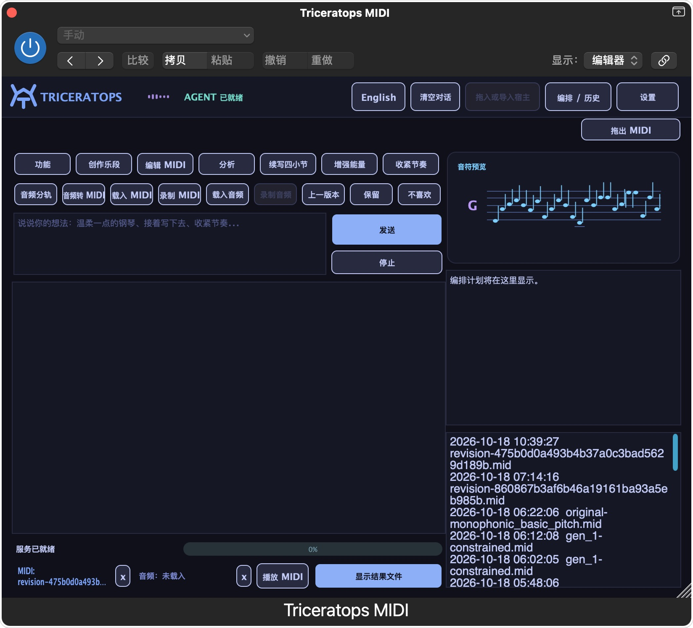
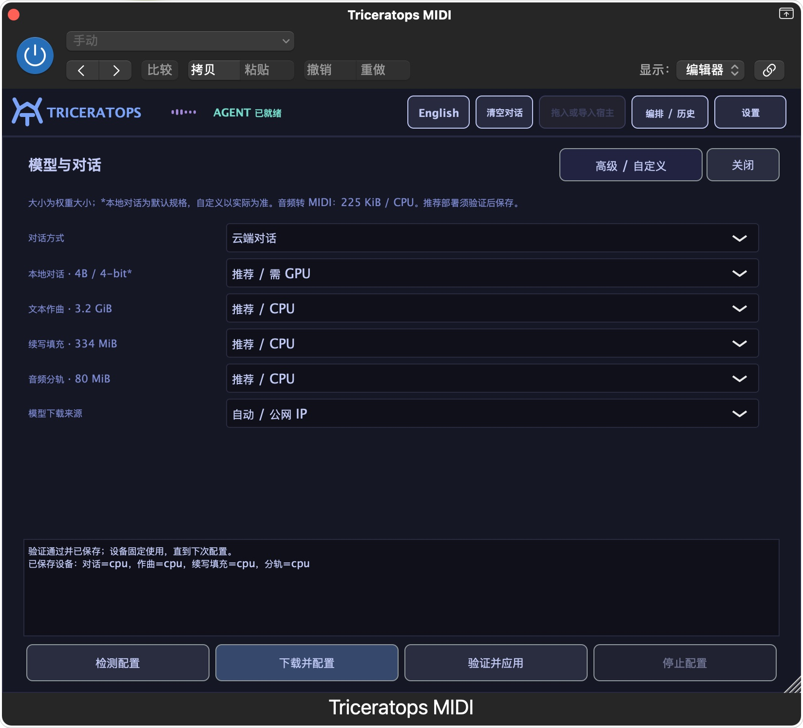

<h1 align="center">Triceratops Music Agent</h1>

🦕 Windows / macOS 音乐插件 · REAPER / Logic Pro

[中文](readme.md) · [English](README.en.md) · [下载安装包](https://github.com/Aolin-MIR/triceratops-music-agent/releases/latest)

 Windows &nbsp;  macOS &nbsp;  REAPER &nbsp;  Logic Pro

## 🎹 支持的平台

| 系统 | 宿主 | 插件 |
| --- | --- | --- |
| Windows 10 / 11 x64 | REAPER x64 | VST3 |
| macOS 14+ · Apple Silicon | REAPER | VST3 |
| macOS 14+ · Apple Silicon | Logic Pro | MIDI FX AU + Audio FX AU |

可用中文或英文描述风格、情绪、乐器和结构，无需 JSON 或固定提示词格式。

Mac 安装器会按需联网配置原生 ARM64 Python 和本地聊天运行环境；不支持 Intel / Rosetta 模型后端。声音输出跟随宿主选择的设备。

## ✨ 1.0 → 1.0.1a 的重要变化

- **1.0.1a Windows 更新**：修复文本生成 MIDI 与连接状态；安装包精简，本地聊天在插件内按需下载，已有模型和设置继续使用。
- **Logic Pro 支持**：MIDI 与音频两个 AU，支持 MIDI 输入捕获、生成输出与音频录制。
- **本地聊天与云端聊天可选**：通过真实工具调用与兼容性检查后启用；自定义入口保留。
- **更自然的意图识别**：创作、编辑、分析与对话分别处理；执行结果依据实际工具反馈。
- **常用操作一步完成**：续写四小节、增强能量、收紧节奏、分轨、转 MIDI，不必先经过聊天。
- **按硬件推荐部署**：检测内存和计算设备；各功能独立配置，验证成功后保存。
- **更完整的音符概览**：横向时间和纵向音高适配，减少内容被截断。
- **工作流更稳**：导入请求独立、重复点击保护、版本回退、后端重连与取消处理得到改进。

查看插件截图

## 🎼 能做什么

| 功能 | 输出 / 操作 |
| --- | --- |
| 文字作曲 | 可编辑 MIDI，保留原始结果与必要后处理记录 |
| 续写、填充、编辑 | 续写小节、指定范围填充、量化、力度、转调与版本回退 |
| 音频工具 | 人声 / 鼓 / 贝斯 / 其他四分轨，单旋律转 MIDI，速度与调性等分析 |
| 宿主协作 | REAPER 手动 / 自动导入；Logic 文件导入、MIDI 输出和录制 |
| 对话与偏好 | 本地或兼容云端聊天、偏好保存、本地知识检索 |

音乐生成和转写具有模型误差，文件生成成功不代表音乐完全符合要求。项目上下文与记忆目前不能视为已实现完整的工程隔离；请在处理前明确载入要编辑的素材。Logic 跨窗口拖拽的自动化验收尚未完成，文件导入和录制可用。

## ⚙️ 安装与部署

从 [Releases](https://github.com/Aolin-MIR/triceratops-music-agent/releases) 选择实际提供的对应系统附件。Mac 解压后双击 `Install Triceratops.command`，安装器自动选择可用源，按需下载并校验 Python 和本地聊天运行环境。再在插件“设置”中一键下载、验证并应用所需依赖与模型。安装包不含大型运行环境或权重，首次使用需联网。备用代理仅传输公开文件，下载必须通过官方固定版本 SHA-256；音乐模型提供官方源与 HF-Mirror，本地聊天权重使用官方注册表。Windows 使用对应安装程序，无需 WSL。

| 功能 | 默认权重大小 | 推荐方式 |
| --- | --- | --- |
| 文本作曲 | 约 3.2 GiB | 依据内存与设备检测；Mac 默认 CPU，可单独验证 GPU |
| 续写与填充 | 约 334 MiB | CPU 起步，GPU 单独验证 |
| 音频四分轨 | 约 80 MiB | CPU 起步，GPU 单独验证 |
| 音频转 MIDI | 约 225 KiB | CPU |
| 本地聊天 | 默认 4B / 4-bit | 足够内存及 GPU；须通过工具调用与设备驻留验证 |

Mac 文本作曲默认保留原始设备精度（CPU 为 FP32），仅自动识别的 8 GB 低内存档使用 FP16；高级设置可手动覆盖。内存读取失败不会当成低配降精度。这是部署选择规则，不是高配实机性能认证，也不会自动启用未验证的 GPU 路径。

大小仅指权重，不是运行内存需求。本地聊天：Windows 使用兼容 NVIDIA GPU 的原生部署，Apple Silicon 使用原生 Metal 部署；8 GB Mac 尚未通过本地 4B 完整宿主验收，可选兼容云端服务。高级设置支持自定义模型标识、服务地址、精度和设备。不会将未通过兼容检查的组合宣称为可用。

## 🌐 音乐模型下载分流

 **Hugging Face 官方源** ·  **HF-Mirror 国内镜像**

按网络出口选择来源，也可手动指定。中国大陆优先检查镜像；镜像不可用时明确重试同一固定版本的官方源，并校验权重。本地聊天运行时使用各自的下载渠道。

## 模型与许可

| 模型 | 下载来源 / 用途 | 许可 |
| --- | --- | --- |
| [MIDI-LLM](https://huggingface.co/slseanwu/MIDI-LLM_Llama-3.2-1B) | 约 3.45 GB，文本生成 MIDI；固定 revision | Llama 3.2 Community License；Built with Llama |
| [MIDI-GPT Yellow Medium](https://huggingface.co/Metacreation/MIDI-GPT) | 约 351 MB，续写 / 填充；固定 revision | 权重 CC BY-NC 4.0，非商业使用 |
| [HTDemucs](https://huggingface.co/adefossez/HTDemucs) | 音频四分轨 | 见模型及 Demucs 上游许可 |
| [Basic Pitch](https://github.com/spotify/basic-pitch) | ONNX 模型随依赖包安装 | Apache 2.0 |

下载器核对 MIDI-LLM、MIDI-GPT、HTDemucs 和解码器资源的 SHA-256；Basic Pitch ONNX 权重也会校验。模型来源、版本和校验值见 [`download_models.py`](text2music/agent/download_models.py)。代码开源不代表所有模型权重具有同一许可；尤其 MIDI-GPT 权重有非商业限制。完整第三方说明见 [THIRD_PARTY_NOTICES.md](THIRD_PARTY_NOTICES.md)。

## 数据与配置

Windows 配置：`%APPDATA%\Triceratops\runtime.json`；模型与专用 Python：`%LOCALAPPDATA%\Triceratops\`；结果和记忆：`%APPDATA%\Triceratops\runs\`。密钥只保存在本机用户配置中，不随插件、发布包或生成结果上传。选择云端模式时会发送对话和必要的工程/分析上下文，API 提供方可能按用量收费。模型自动选源会向 IP 地理位置服务发起请求，只保留国家码和查询时间，不保存公网 IP、城市或精确位置；使用代理/VPN 时观察到的是实际出口。可手选来源跳过查询。服务只监听 `127.0.0.1:49327`。

## 试用反馈

请到 [Issues](https://github.com/Aolin-MIR/triceratops-music-agent/issues) 提交系统版本、REAPER 版本、CPU/GPU、操作步骤、预期与实际结果。不要上传 API key 或含私密素材的完整配置。欢迎分享一小段可复现 MIDI 或音频。

## 致谢

本项目实际调用的音乐模型与工具：

- [MIDI-LLM / Shih-Lun Wu 等](https://github.com/slSeanWU/MIDI-LLM)：自然语言生成多乐器 MIDI；基于 Llama 3.2 并扩展音乐词表，Built with Llama。
- [MIDI-GPT / Metacreation Lab](https://github.com/Metacreation/MIDI-GPT)：使用 **Yellow Medium** 权重进行续写与填充；保留 CC BY-NC 4.0 限制。
- [HTDemucs / Alexandre Défossez 等](https://github.com/facebookresearch/demucs)：人声、鼓、贝斯和其他声部的四分轨。
- [Basic Pitch / Spotify](https://github.com/spotify/basic-pitch)：使用 ICASSP 2022 ONNX 模型转写 MIDI。
- [Anticipation / John Thickstun 等](https://github.com/jthickstun/anticipation)：MIDI-LLM 使用的音乐事件转换 / 解码工具；[JUCE](https://github.com/juce-framework/JUCE) 提供 VST3 框架；[librosa](https://github.com/librosa/librosa) 提供音频分析算法。

聊天可选用户配置的云端模型或经兼容性检查的本地 Qwen3.5 模型；Windows 本地推理由 llama.cpp Vulkan GPU 后端执行，发行包不附带聊天模型权重。未接入的候选模型不列入上述使用致谢。

也感谢 [Anticipation](https://github.com/jthickstun/anticipation)、[JUCE](https://github.com/juce-framework/JUCE) 和 [librosa](https://github.com/librosa/librosa)。第三方许可见 [NOTICE](NOTICE)。
